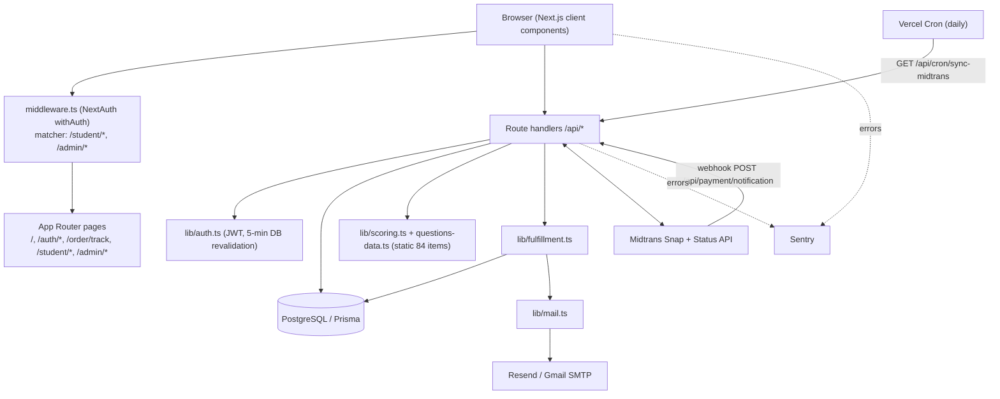
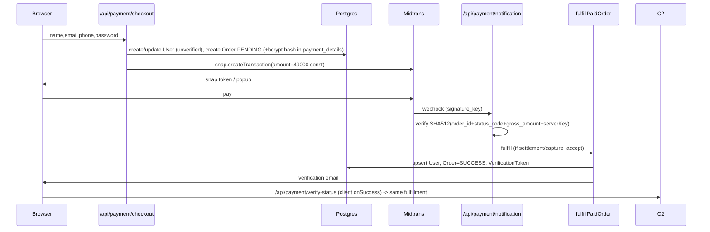

# ARCHITECTURE MAP

Audit date: 2026-10-26 · Basis: repository inspection (commit `66fbe39`, branch `main`, clean working tree at audit start). Live database/Vercel/Midtrans dashboards were **not** accessed.

## 1. Detected stack (from `package.json`, `prisma/`, `src/`)

| Layer | Technology | Evidence |
|---|---|---|
| Framework | Next.js 14.2.15 (App Router), React 18, TypeScript | `package.json`, `src/app/**` |
| Styling / UI | Tailwind 3, framer-motion, lucide-react | `package.json` |
| Auth | NextAuth v4, Credentials provider, JWT sessions (30 d), bcryptjs (cost 10) | `src/lib/auth.ts` |
| DB / ORM | PostgreSQL (Supabase pooler, per migration log) via Prisma 5.22 | `prisma/schema.prisma` |
| Payments | Midtrans Snap (`midtrans-client`) + Status API via `fetch` | `src/lib/midtrans.ts`, `api/payment/*` |
| Email | Resend SDK → fallback Nodemailer (Gmail SMTP) → console mock | `src/lib/mail.ts` |
| Monitoring | `@sentry/nextjs` (client/server/edge configs, DSN from env) | `sentry.*.config.ts`, `next.config.mjs` |
| Validation | Zod (env only) | `src/lib/env.ts` |
| PDF / export | `@react-pdf/renderer`, `xlsx@0.18.5` | `api/assessment/results/**/pdf`, `api/admin/export` |
| Hosting | Vercel (Hobby plan, one daily cron) | `vercel.json` |
| Tests / CI | **None found** (no test files, no `.github/`, no ESLint config tracked) | `git ls-files` |

Single application (no monorepo, no separate services).

## 2. Component diagram

## 3. API inventory and access model

| Route | Method | Auth enforced in handler | Notes |
|---|---|---|---|
| `/api/auth/[...nextauth]` | GET/POST | n/a | Credentials login; **no rate limit** |
| `/api/auth/register` | POST | public | 409 reveals existing email |
| `/api/auth/verify` | GET, POST | token | GET mutates state |
| `/api/auth/resend-verification` | POST | public | 60 s cooldown (in-memory + DB) |
| `/api/auth/forgot-password` | POST | public | 60 s cooldown, generic response |
| `/api/auth/reset-password` | POST | token | sets `is_active=true` |
| `/api/payment/checkout` | POST | optional session | creates User + Order **before** payment |
| `/api/payment/notification` | POST | Midtrans signature | webhook |
| `/api/payment/verify-status` | POST | **none** | triggers Midtrans status query + fulfillment |
| `/api/payment/simulate-success` | POST | none, blocked if `NODE_ENV=production` | dev only |
| `/api/order/track` | POST | none (email+order_id), in-memory IP limit 5/min | |
| `/api/cron/sync-midtrans` | GET | `CRON_SECRET` | reconciliation |
| `/api/assessment/start` | GET | session + paid + verified | **GET creates a session row** |
| `/api/assessment/answer` | POST | session + ownership | |
| `/api/assessment/complete` | POST | session + ownership | atomic `updateMany` lock |
| `/api/assessment/results/[sessionId]` (+`/pdf`) | GET | session + ownership/ADMIN | |
| `/api/assessment/career-profile` | GET, POST | session only | **no ownership check on `sessionId`** |
| `/api/user/{profile,password,delete}` | PUT/POST/DELETE | session | |
| `/api/admin/*` (students, transactions, export, questions, force-unlock-user) | various | `role === "ADMIN"` in every handler | middleware does not cover `/api` |

Middleware (`src/middleware.ts`) protects only page routes; every API handler performs its own check (verified by grep: each handler calls `getServerSession`; admin handlers additionally check `role`).

## 4. Critical request flows

### 4.1 Guest purchase

### 4.2 Assessment
`GET /start` (paywall → email-verified → find/create IN_PROGRESS session → seeded shuffle) → `POST /answer` ×84 (upsert on `(session_id, question_id)`) → `POST /complete` (answer-count check → `calculateAssessmentScores` → atomic `updateMany WHERE status=IN_PROGRESS` persisting `result_data`) → `GET /results/[id]` / `/pdf` read `result_data`.

## 5. Architectural observations (see FINDINGS_REGISTER for IDs)

* Business rules (price, paywall, verification, ownership) are enforced server-side – good.
* Scoring is driven by a **static** question bank (`all84QuestionsData`) while questions are also stored in DB and editable by admins → two sources of truth (F-14).
* Fulfillment is invoked from three entry points (webhook, verify-status, cron) without a database-level atomic claim (F-06).
* In-memory rate limiting / cooldown maps are per-serverless-instance (F-09).
* Dev/mock fallbacks remain in several routes (`admin/questions*` fake success, `career-profile` synthetic answers) (F-08, F-12).
* No automated tests, CI, or security headers (F-17, F-18).
