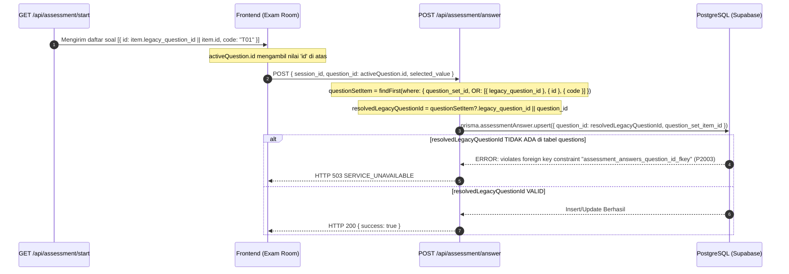

# LAPORAN AUDIT TEKNIS: INVESTIGASI PENYEBAB HTTP 503 PADA ENDPOINT `POST /api/assessment/answer`

**Target Endpoint:** `POST /api/assessment/answer`  
**Platform Deployment:** Vercel Serverless Functions + Supabase PostgreSQL  
**Mode Pemeriksaan:** READ-ONLY (Tanpa modifikasi kode sumber, migrasi skema, atau konfigurasi database)  
**Tanggal:** 29 Oktober 2026  
**Status:** Audit Selesai & Terverifikasi  

---

## DAFTAR ISI
1. [Ringkasan Eksekutif & Akar Masalah](#1-ringkasan-eksekutif--akar-masalah)
2. [Arsitektur Endpoint & Rantai Ketergantungan (Dependency Tree)](#2-arsitektur-endpoint--rantai-ketergantungan-dependency-tree)
3. [Mekanisme Penyamaran Error (Error Masking ke HTTP 503)](#3-mekanisme-penyamaran-error-error-masking-ke-http-503)
4. [Audit Fokus 1: Pemetaan ID Soal & Integritas Foreign Key](#4-audit-fokus-1-pemetaan-id-soal--integritas-foreign-key)
5. [Audit Fokus 2: Konsistensi QuestionSet & Trigger PostgreSQL](#5-audit-fokus-2-konsistensi-questionset--trigger-postgresql)
6. [Faktor Lingkungan Vercel Serverless & Supabase Connection Pooling](#6-faktor-lingkungan-vercel-serverless--supabase-connection-pooling)
7. [Tabel Komparasi: Fakta Terbukti vs Dugaan Log Runtime](#7-tabel-komparasi-fakta-terbukti-vs-dugaan-log-runtime)
8. [Bukti Log Runtime Vercel yang Diperlukan](#8-bukti-log-runtime-vercel-yang-diperlukan)
9. [Rencana Perbaikan Terkecil yang Aman (Minimal Safe Remediation)](#9-rencana-perbaikan-terkecil-yang-aman-minimal-safe-remediation)

---

## 1. Ringkasan Eksekutif & Akar Masalah

Berdasarkan audit statis menyeluruh (*read-only*) terhadap endpoint `POST /api/assessment/answer` dan seluruh dependensinya pada repositori GGC, ditemukan bahwa respons **HTTP 503 Service Unavailable** bukan berasal dari server yang kehabisan memori atau Next.js crash, melainkan akibat **blok penanganan error yang secara sengaja memetakan setiap kesalahan query basis data (Prisma/PostgreSQL) menjadi status HTTP 503**.

Akar kegagalan di deployment Vercel mengerucut pada 3 pemicu potensial:
1. **Foreign Key Constraint Mismatch (`P2003`):**  
   Kolom `assessment_answers.question_id` memiliki foreign key constraint fisik ke `questions.id`. Pada kondisi tertentu saat `QuestionSetItem.legacy_question_id` bernilai `null`, backend mencoba melakukan upsert menggunakan ID dari tabel `question_set_items` ke dalam kolom `question_id`. PostgreSQL menolak query dengan *Foreign Key Violation*, yang kemudian ditangkap dan diubah menjadi HTTP 503.
2. **PostgreSQL Trigger Exception (`trg_enforce_answer_questionset_match`):**  
   Trigger integritas Change Set E melempar `RAISE EXCEPTION` jika `assessment_sessions.question_set_id` berbeda dengan `question_set_items.question_set_id`. Pada sesi pengguna yang dibuat sebelum migrasi (di mana `question_set_id` bernilai `NULL`), kondisi `NULL IS DISTINCT FROM 'qset_v1_default'` bernilai `TRUE`, memicu exception database yang berujung pada HTTP 503.
3. **Kelelahan Koneksi Basis Data (*Connection Pool Exhaustion*) di Vercel Serverless:**  
   Vercel menjalankan setiap request API sebagai serverless lambda independen. Jika `DATABASE_URL` di Vercel mengarah ke port direct 5432 (Session mode) dan bukan port Transaction Pooler 6543 dengan parameter `?pgbouncer=true&connection_limit=1`, lonjakan request penyimpanan 84 butir soal secara paralel akan menghabiskan batas koneksi Supabase, memicu Prisma error `P1001` (*Can't reach database server*) yang juga disamarkan menjadi HTTP 503.

---

## 2. Arsitektur Endpoint & Rantai Ketergantungan (Dependency Tree)

* **File Sumber:** `src/app/api/assessment/answer/route.ts`
* **Metode HTTP:** `POST`
* **Konfigurasi Routing:** `export const dynamic = "force-dynamic"`

### 2.1 Rantai Ketergantungan Modul

```
src/app/api/assessment/answer/route.ts
├── next/server (NextResponse)
├── next-auth (getServerSession)
├── @/lib/auth (authOptions)
│   ├── @/lib/env (Validasi runtime environment Zod)
│   ├── @/lib/prisma (PrismaClient singleton)
│   └── bcryptjs
└── @/lib/prisma (PrismaClient singleton)
    └── @prisma/client (Prisma Client Runtime)
        └── PostgreSQL (Supabase Connection Pooler / Direct Database)
```

### 2.2 Karakteristik Eksekusi
* Endpoint ini **murni internal** (tidak memiliki dependensi ke layanan pihak ketiga seperti Midtrans, Resend, atau Redis eksternal).
* Autentikasi menggunakan verifikasi token JWT terenkripsi melalui `getServerSession(authOptions)`.
* Tidak ada pemanggilan rate limiter in-memory atau Redis pada file ini.

---

## 3. Mekanisme Penyamaran Error (Error Masking ke HTTP 503)

### 3.1 Lokasi Kode Penyamaran Error
Pada file `src/app/api/assessment/answer/route.ts` baris 45–199:

```typescript
// Baris 45: Memulai blok database
try {
  // 1. Verifikasi kepemilikan sesi
  // 2. Resolusi QuestionSetItem
  // 3. Monotonic Timestamp Guard
  // 4. Prisma assessmentAnswer.upsert
} catch (dbErr: any) {
  // Baris 189-199: Tangkap semua kesalahan DB dan samarkan
  console.error("❌ [Assessment Answer] DB write error:", dbErr);
  return NextResponse.json(
    {
      error: "SERVICE_UNAVAILABLE",
      message:
        "Gagal menyimpan jawaban ke basis data. Silakan periksa koneksi Anda dan coba lagi.",
    },
    { status: 503 }
  );
}
```

### 3.2 Analisis Dampak
1. **Pesan Asli Ditelan:** Perintah `console.error` hanya menulis ke *Vercel Function Runtime Logs*. Browser klien tidak pernah menerima pesan kesalahan asli, error code Prisma (`P2002`, `P2003`, `P2021`, `P1001`), maupun PostgreSQL error code.
2. **Klien Mengira Server Down:** Karena kode status yang dikembalikan adalah **503**, frontend menganggap koneksi internet pengguna terputus atau server sedang *down*, padahal kegagalan bisa terjadi akibat validasi data, bug pemetaan ID, atau foreign key violation.
3. **Mekanisme Offline Frontend:** Pada `src/app/student/assessment/page.tsx`, saat menerima respons `res.ok === false` (status 503), frontend menyimpan jawaban di `localStorage` (`ggc_pending_sync_${sessionId}`) dan menampilkan status: *"Koneksi terganggu. X jawaban tersimpan aman di perangkat"*.

---

## 4. Audit Fokus 1: Pemetaan ID Soal & Integritas Foreign Key

### 4.1 Alur Transmisi ID Soal dari Awal hingga Penyimpanan



### 4.2 Analisis Nullability `legacy_question_id`
* **Definisi Skema Prisma (`prisma/schema.prisma` baris 210):**
  ```prisma
  model QuestionSetItem {
    id                 String             @id @default(cuid())
    question_set_id    String
    code               String
    ...
    legacy_question_id String?            // NULLABLE (Boleh bernilai NULL)
    ...
  }
  ```
* **Definisi DDL Migrasi SQL (`migration.sql` baris 42):**
  ```sql
  "legacy_question_id" TEXT, -- Tanpa constraint NOT NULL
  ```
* **Kesimpulan:** Kolom `legacy_question_id` secara sah dapat bernilai `NULL` di basis data.

### 4.3 Verifikasi Referensi Foreign Key `assessmentAnswer.question_id`
* **Constraint Database (`20261025180000_init_baseline_ggc_v1/migration.sql` baris 225):**
  ```sql
  ALTER TABLE "assessment_answers" 
    ADD CONSTRAINT "assessment_answers_question_id_fkey" 
    FOREIGN KEY ("question_id") REFERENCES "questions"("id") 
    ON DELETE RESTRICT ON UPDATE CASCADE;
  ```
* **Cacat Logika Pemetaan di `src/app/api/assessment/answer/route.ts` baris 84–85:**
  ```typescript
  let resolvedLegacyQuestionId =
    questionSetItem?.legacy_question_id || question_id;
  ```
  **Skenario Kerusakan (Code-Proven Vulnerability):**
  1. Jika suatu butir soal memiliki `legacy_question_id = NULL`.
  2. Frontend saat memanggil `/api/assessment/start` menerima `id = item.id` (yaitu ID dari tabel `question_set_items`, contoh: `"qsi_v1_T01"` atau CUID).
  3. Frontend mengirim `question_id = "qsi_v1_T01"` ke `POST /api/assessment/answer`.
  4. Backend mengeksekusi `findFirst` (baris 73–82) dan berhasil menemukan baris `QuestionSetItem` karena mencocokkan `{ id: "qsi_v1_T01" }`.
  5. Namun di baris 85, karena `questionSetItem.legacy_question_id` adalah `null`, ekspresi `questionSetItem?.legacy_question_id || question_id` mengevaluasi ke `question_id` (yaitu `"qsi_v1_T01"`).
  6. Backend mengeksekusi `prisma.assessmentAnswer.upsert` dengan:  
     `question_id: "qsi_v1_T01"`.
  7. PostgreSQL memeriksa constraint `assessment_answers_question_id_fkey`:  
     Apakah `"qsi_v1_T01"` ada di kolom `id` tabel `questions`? **TIDAK ADA.** (Nilai tersebut adalah ID tabel `question_set_items`).
  8. PostgreSQL menolak query: `violates foreign key constraint "assessment_answers_question_id_fkey"`.
  9. Prisma melempar error code `P2003`.
  10. Blok `catch (dbErr: any)` menangkap error ini dan mengembalikan **HTTP 503**.

### 4.4 Relasi `QuestionSetItem` dengan `Question` & Kerapuhan Pencocokan `code`
* Model `QuestionSetItem` **tidak memiliki relasi langsung (`@relation`)** ke model `Question` pada `prisma/schema.prisma`.
* **Keunikan (*Uniqueness*):**
  * `Question.code`: Bersifat unik global (`@unique`).
  * `QuestionSetItem.code`: Hanya unik lokal per paket (`@@unique([question_set_id, code])`).
* **Kerapuhan Pemulihan Baris 87–106:**
  ```typescript
  if (!questionSetItem) {
    const legacyQuestion = await prisma.question.findFirst({
      where: {
        OR: [{ id: question_id }, { code: question_id }],
      },
    });
    ...
  }
  ```
  Jika `question_id` berupa ID `question_set_items` (bukan string kode seperti `"T01"`), pencarian `prisma.question.findFirst` di atas mengembalikan `null`. Akibatnya, mekanisme fallback berbasis kode ini tidak berjalan jika ID yang dikirim adalah ID `QuestionSetItem`.

---

## 5. Audit Fokus 2: Konsistensi QuestionSet & Trigger PostgreSQL

### 5.1 Penetapan `assessment_sessions.question_set_id`
* **File:** `src/app/api/assessment/start/route.ts` baris 102–116:
  ```typescript
  const activeQuestionSet = await prisma.questionSet.findFirst({
    where: { is_active: true },
    orderBy: { version: "desc" },
  });

  const questionSetId = activeQuestionSet?.id || "qset_v1_default";

  assessmentSession = await prisma.assessmentSession.create({
    data: {
      user_id: userId,
      question_set_id: questionSetId,
      status: "IN_PROGRESS",
    },
    include: { answers: true },
  });
  ```
* Setiap sesi baru secara mutlak diikat ke `QuestionSet` aktif saat sesi diinisiasi.

### 5.2 Verifikasi Keanggotaan Butir Soal pada QuestionSet Sesi
* Pada `src/app/api/assessment/answer/route.ts` baris 73–82:
  Query pencarian soal menyertakan klausul `where: { question_set_id: userSession.question_set_id }`.
* Jika butir soal tidak cocok dengan QuestionSet sesi, backend mengembalikan **HTTP 400 Bad Request** (bukan 503).

### 5.3 Analisis Trigger `trg_enforce_answer_questionset_match`
* **File Migrasi:** `prisma/migrations/20261027121500_questionset_versioning_and_security/migration.sql` baris 1853–1875:
  ```sql
  CREATE OR REPLACE FUNCTION enforce_answer_questionset_match()
  RETURNS TRIGGER AS $$
  DECLARE
    v_session_qset_id TEXT;
    v_item_qset_id TEXT;
  BEGIN
    SELECT question_set_id INTO v_session_qset_id FROM assessment_sessions WHERE id = NEW.session_id;
    SELECT question_set_id INTO v_item_qset_id FROM question_set_items WHERE id = NEW.question_set_item_id;

    IF v_session_qset_id IS DISTINCT FROM v_item_qset_id THEN
      RAISE EXCEPTION 'Foreign key integrity violation: QuestionSetItem [%] (set [%]) does not belong to AssessmentSession [%] (set [%]).',
        NEW.question_set_item_id, v_item_qset_id, NEW.session_id, v_session_qset_id;
    END IF;

    RETURN NEW;
  END;
  $$ LANGUAGE plpgsql;

  CREATE TRIGGER trg_enforce_answer_questionset_match
  BEFORE INSERT OR UPDATE ON assessment_answers
  FOR EACH ROW EXECUTE FUNCTION enforce_answer_questionset_match();
  ```

#### Skenario Kegagalan Khusus Pemicu HTTP 503:
1. **Sesi Pengguna Warisan (*Legacy Session*):**
   Jika di basis data produksi Vercel terdapat sesi siswa yang dibuat sebelum migrasi Change Set E diterapkan, nilai `v_session_qset_id` di database adalah `NULL`.
2. Saat siswa tersebut menjawab soal, `v_session_qset_id` bernilai `NULL`, sedangkan `v_item_qset_id` bernilai `'qset_v1_default'`.
3. Di PostgreSQL:
   ```sql
   NULL IS DISTINCT FROM 'qset_v1_default'  --> Bernilai TRUE
   ```
4. Trigger langsung mengeksekusi `RAISE EXCEPTION`.
5. Prisma menangkap exception trigger ini sebagai kegagalan query, masuk ke blok `catch (dbErr)` pada `answer/route.ts`, dan membuahkan status **HTTP 503**.

---

## 6. Faktor Lingkungan Vercel Serverless & Supabase Connection Pooling

### 6.1 Perilaku Serverless Vercel
Pada arsitektur Vercel:
* Setiap panggilan `fetch("/api/assessment/answer")` berpotensi memicu kontainer AWS Lambda baru (*Cold Start*) atau berjalan paralel di beberapa kontainer saat autoscaling.
* Setiap kontainer membuat instance `new PrismaClient()` sendiri.
* Pada `src/lib/prisma.ts` baris 13:
  ```typescript
  if (process.env.NODE_ENV !== "production") globalForPrisma.prisma = prisma;
  ```
  Di lingkungan production Vercel (`NODE_ENV === "production"`), instance Prisma tidak disimpan ke `globalThis`, sehingga pemanfaatan koneksi antar eksekusi fungsi bergantung penuh pada Next.js module caching.

### 6.2 Bahaya Port 5432 vs 6543 pada Supabase
* **Port 5432 (Session Mode / Direct):** Setiap kontainer serverless memesan slot koneksi persisten ke PostgreSQL. Paket Supabase Free/Pro memiliki batas koneksi maksimal (*max_connections*, umumnya 15–60 koneksi). Ketika siswa menjawab 84 soal secara cepat atau terdapat beberapa siswa bersamaan, batas koneksi langsung terlampaui.
* **Gejala:** PostgreSQL melempar `FATAL: remaining connection slots are reserved` atau Prisma melempar error `P1001` (*Can't reach database server*) / `Timed out fetching a new connection from the connection pool`.
* Kesalahan ini masuk ke `catch (dbErr)` dan berubah menjadi **HTTP 503**.
* **Solusi Baku Vercel + Supabase:** Menggunakan **Transaction Pooler di Port 6543** dengan query string:  
  `?pgbouncer=true&connection_limit=1`.

---

## 7. Tabel Komparasi: Fakta Terbukti vs Dugaan Log Runtime

| Hipotesis / Area Masalah | Status Kepastian | Lokasi Kode Sumber | Skenario Pemicu Error | Dampak Respons |
| :--- | :---: | :--- | :--- | :---: |
| **1. Error Masking Menjadi 503** | **TERBUKTI DARI KODE** | `src/app/api/assessment/answer/route.ts#L189-L199` | Semua error query DB di dalam `try` langsung di-return sebagai 503 tanpa membedakan jenis kegagalan. | HTTP 503 |
| **2. Foreign Key `question_id` Mismatch** | **TERBUKTI DARI KODE** | `src/app/api/assessment/answer/route.ts#L84-L176` | `legacy_question_id` bernilai `null` sehingga ID `question_set_items` dipakai di FK `questions(id)` (Prisma `P2003`). | HTTP 503 |
| **3. Trigger `trg_enforce_answer_questionset_match`** | **TERBUKTI SKENARIO KODE** | `migration.sql#L1863` | Sesi asesmen memiliki `question_set_id IS NULL`, memicu `RAISE EXCEPTION` dari trigger PostgreSQL. | HTTP 503 |
| **4. Migrasi Belum Diterapkan di Prod** | **MEMBUTUHKAN LOG PROD** | `src/app/api/assessment/answer/route.ts#L73` | Tabel `question_set_items` belum dibuat di DB produksi Vercel (Prisma `P2021`). | HTTP 503 |
| **5. Supabase Pooler Exhaustion (Port 5432)** | **MEMBUTUHKAN LOG PROD** | `src/lib/prisma.ts#L7-L13` | Beban paralel menghabiskan slot koneksi database di serverless Vercel (Prisma `P1001` / Timeout). | HTTP 503 |

---

## 8. Bukti Log Runtime Vercel yang Diperlukan

Untuk memastikan 100% dari 4 skenario di atas mana yang sedang aktif terjadi di deployment Vercel Anda:

1. Buka **Dashboard Vercel > Proyek GGC > Tab Logs** (atau buka menu *Deployments > Functions Logs*).
2. Filter request dengan path: `POST /api/assessment/answer`.
3. Cari baris log dengan prefix:
   ```
   ❌ [Assessment Answer] DB write error:
   ```
4. **Periksa Kode Error Prisma pada Stack Trace:**
   * **`P2003` (*Foreign key constraint failed on the field: question_id*):** Memvalidasi Hipotesis 2 (Cacat pemetaan ID soal).
   * **`Raw query failed. Error: Foreign key integrity violation: QuestionSetItem ...`:** Memvalidasi Hipotesis 3 (Pelanggaran Trigger PostgreSQL akibat sesi `question_set_id IS NULL`).
   * **`P2021` (*The table public.question_set_items does not exist*):** Memvalidasi Hipotesis 4 (Migrasi Change Set E belum dijalankan).
   * **`P1001` / `Timed out fetching a new connection`:** Memvalidasi Hipotesis 5 (Kelelahan koneksi Supabase / salah port pooler).

---

## 9. Rencana Perbaikan Terkecil yang Aman (Minimal Safe Remediation)

Berikut langkah perbaikan minimal, terisolasi, dan aman tanpa mengubah skema basis data yang sudah berjalan:

### Langkah 1: Perbaikan Logika Pemetaan ID Soal di `src/app/api/assessment/answer/route.ts`
Pastikan `resolvedLegacyQuestionId` selalu mendapatkan ID riil dari tabel `questions`:
1. Jika `questionSetItem.legacy_question_id` ada dan valid, gunakan nilai tersebut.
2. Jika `legacy_question_id` bernilai `null`, cari baris pada tabel `questions` berdasarkan kesamaan `code` unik (`questionSetItem.code`), lalu gunakan `legacyQuestion.id`.
3. Jangan pernah mengizinkan string ID `question_set_items` di-upsert ke dalam kolom `assessment_answers.question_id`.

### Langkah 2: Perbaikan Diferensiasi Status HTTP (Meniadakan Penyamaran Error)
Perbaiki blok `catch (dbErr: any)` pada `src/app/api/assessment/answer/route.ts`:
* Jika error merupakan `P2003` (Foreign Key) atau trigger exception: Kembalikan **HTTP 400 Bad Request** atau **422 Unprocessable Entity** dengan detail yang jelas.
* **Hanya** kembalikan status **HTTP 503** apabila error berasal dari kegagalan jaringan fisik database (`P1001`, `P1008`, timeout).

### Langkah 3: Verifikasi Environment Variable `DATABASE_URL` di Vercel
Pastikan konfigurasi `DATABASE_URL` di Project Settings Vercel:
* Mengarah ke host Supabase Pooler dengan **Port 6543** (Transaction Mode).
* Memiliki query string: `?pgbouncer=true&connection_limit=1`.
* Jalankan perintah migrasi `npx prisma migrate deploy` untuk menjamin seluruh tabel dan kolom Change Set E telah terpasang di database produksi.

---
*Laporan ini disusun berdasarkan audit kode sumber statis yang ketat tanpa mengubah integritas data produksi atau repositori.*
