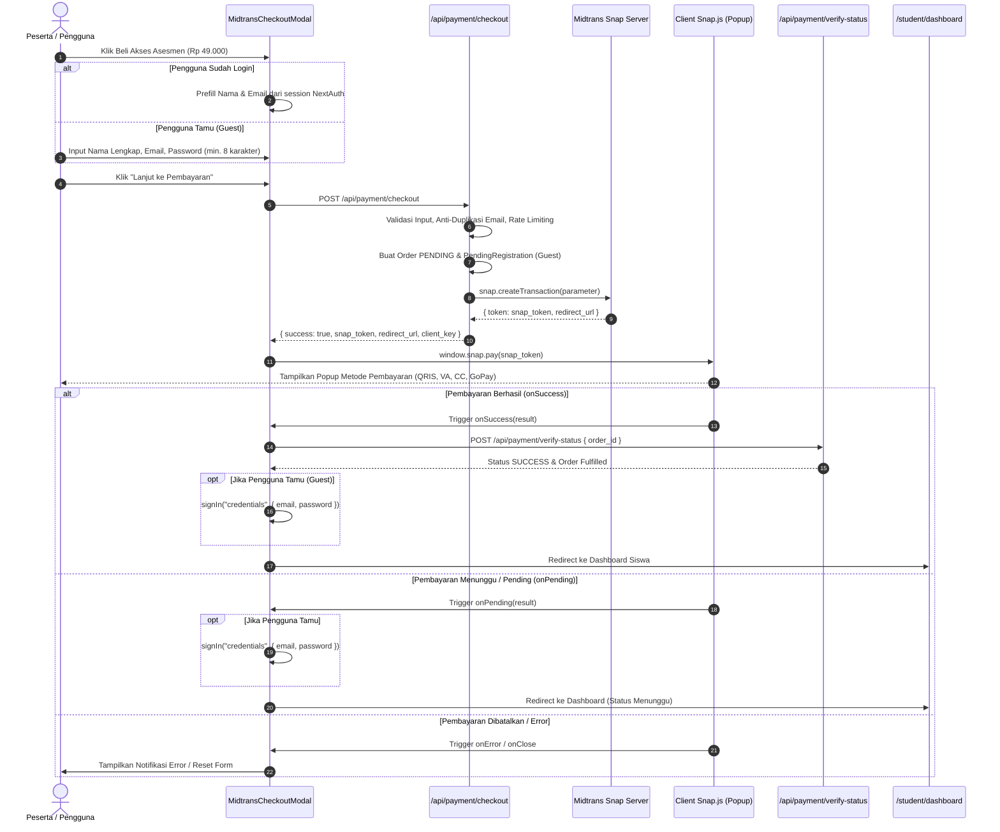

# LAPORAN AUDIT TEKNIS INTEGRASI PEMBAYARAN MIDTRANS SNAP SANDBOX
**Platform:** Go Great Career (GGC) Study Fit Assessment Platform  
**Mode Pemeriksaan:** READ-ONLY (Tanpa modifikasi source code, migrasi database, atau konfigurasi environment)  
**Tanggal:** 28 Oktober 2026  
**Status:** Audit Selesai & Tervalidasi  

---

## DAFTAR ISI
1. [Komponen Inisiasi Pembayaran & Alur Pengguna (User Flow)](#1-komponen-inisiasi-pembayaran--alur-pengguna-user-flow)
2. [API Route Backend Pembuat Snap Token](#2-api-route-backend-pembuat-snap-token)
3. [Implementasi SDK Midtrans & Direct API](#3-implementasi-sdk-midtrans--direct-api)
4. [Daftar & Referensi Environment Variables](#4-daftar--referensi-environment-variables)
5. [Target Lingkungan: Sandbox vs Production](#5-target-lingkungan-sandbox-vs-production)
6. [Mekanisme Loading Snap.js & Penanganan Token](#6-mekanisme-loading-snapjs--penanganan-token)
7. [Endpoint Webhook/Notifikasi & Verifikasi Signature](#7-endpoint-webhooknotifikasi--verifikasi-signature)
8. [Model Basis Data & Siklus Data Transaksi](#8-model-basis-data--siklus-data-transaksi)
9. [Mekanisme Pembukaan Akses Asesmen Berbayar](#9-mekanisme-pembukaan-akses-asesmen-berbayar)
10. [Penanganan State Transaksi, Duplikasi & Out-of-Order](#10-penanganan-state-transaksi-duplikasi--out-of-order)
11. [Error Handling, Logging, Pengujian & Konfigurasi](#11-error-handling-logging-pengujian--konfigurasi)
12. [Klasifikasi Temuan: Isu Terkonfirmasi vs Unverifiable](#12-klasifikasi-temuan-isu-terkonfirmasi-vs-unverifiable)
13. [Checklist Diagnostik Sandbox Testing](#13-checklist-diagnostik-sandbox-testing)

---

## 1. Komponen Inisiasi Pembayaran & Alur Pengguna (User Flow)

### 1.1 Komponen Frontend
* **Komponen Utama:** `src/components/MidtransCheckoutModal.tsx`
* **Komponen Pembungkus (Wrapper):** `src/components/BuyAssessmentButton.tsx`
* **Lokasi Pemasangan (Entry Points):**
  1. **Landing Page (`src/app/page.tsx`):**
     * Tombol CTA di Hero Section
     * Modul rekomendasi interaktif `InteractiveMajorMatcher.tsx`
     * Section Paket Harga (Pricing Card)
     * Sticky Floating Bar `FloatingCtaBar.tsx`
  2. **Dashboard Siswa (`src/app/student/dashboard/page.tsx`):**
     * Banner "Akses Asesmen Terkunci" merender `<BuyAssessmentButton />`.
  3. **Ruang Ujian Asesmen (`src/app/student/assessment/page.tsx`):**
     * Layar blokir Paywall otomatis merender `<MidtransCheckoutModal />` saat API `/api/assessment/start` mengembalikan status HTTP 402 `PAYMENT_REQUIRED`.

### 1.2 Diagram Alur Pengguna (User Flow)



---

## 2. API Route Backend Pembuat Snap Token

* **File:** `src/app/api/payment/checkout/route.ts`
* **Metode:** `POST`
* **Konfigurasi Eksekusi:** `export const dynamic = "force-dynamic"`

### Logika & Aturan Bisnis:
1. **Rate Limiting (F-09):** Menggunakan `consumeRateLimit("checkout:ip:<IP>", 10, 60_000)` membatasi maksimal 10 request pembuatan checkout per menit per alamat IP.
2. **Pencegahan Akun Duplikat (F-15):** Jika email tamu sudah memiliki akun berstatus terverifikasi, akun admin, atau memiliki riwayat pembayaran sukses, API mengembalikan HTTP 409 (`EMAIL_ALREADY_REGISTERED`) agar pengguna login terlebih dahulu.
3. **Integritas Nominal (Server-Side Price Lock):** Harga dikunci secara konstan di server: `DEFAULT_ASSESSMENT_PRICE = 49000` (Rp 49.000). Nominal tidak dapat dimanipulasi dari frontend.
4. **Format Order ID:** Menggunakan pola unik berbasis timestamp dan angka acak kriptografi:  
   `orderId = GGC-${Date.now()}-${crypto.randomInt(1000, 10000)}`
5. **Penyimpanan Kredensial Tamu (F-14):** Password di-hash menggunakan `bcrypt.hash(password, 10)` dan disimpan pada tabel terisolasi `PendingRegistration` dengan masa berlaku 24 jam (`pendingExpiresAt`). Akun `User` riil **tidak dibuat** sebelum pembayaran terbukti settlement.
6. **Parameter Transaksi Midtrans:**
   * `transaction_details`: `{ order_id, gross_amount: 49000 }`
   * `customer_details`: `{ first_name, email, phone }`
   * `item_details`: Item tunggal `"GGC-STUDY-FIT-FULL"` senilai Rp 49.000.
   * `callbacks`: `{ finish: "${NEXTAUTH_URL}/student/dashboard" }`
7. **Penyimpanan Token:** Menyimpan `snap_token` dan `snap_redirect_url` ke baris `Order` di PostgreSQL.
8. **Dev Fallback Safety:** Fallback `mock-snap-token-${orderId}` hanya diizinkan aktif apabila `NODE_ENV !== "production"` dan server key tidak terkonfigurasi. Di production, kegagalan koneksi Midtrans langsung mengembalikan HTTP 502 Bad Gateway.

---

## 3. Implementasi SDK Midtrans & Direct API

### 3.1 Paket SDK yang Terpasang
Berdasarkan `package.json`:
* `"midtrans-client": "^1.4.3"`
* `"@types/midtrans-client": "^1.4.0"`

### 3.2 Inisialisasi SDK
* **File:** `src/lib/midtrans.ts` (baris 15-19)
```typescript
export const snap = new midtransClient.Snap({
  isProduction: MIDTRANS_IS_PRODUCTION,
  serverKey: MIDTRANS_SERVER_KEY,
  clientKey: MIDTRANS_CLIENT_KEY,
});
```

### 3.3 Direct API (REST HTTP)
Selain SDK untuk Snap Token, sistem menggunakan panggilan direct `fetch` ke endpoint resmi Midtrans Core API:
* **File:** `src/app/api/payment/verify-status/route.ts` dan `src/app/api/cron/sync-midtrans/route.ts`
* **Endpoint:** `${MIDTRANS_CORE_API_BASE_URL}/v2/${encodeURIComponent(order_id)}/status`
* **Autentikasi:** HTTP Basic Auth menggunakan header `Authorization: Basic base64(serverKey + ":")`.
* **Alasan:** Rekonsiliasi status instan dan independen tanpa dependensi cache SDK.

---

## 4. Daftar & Referensi Environment Variables

Sistem memvalidasi dan mereferensikan variabel-variabel lingkungan berikut *(Nilai rahasia tidak ditampilkan demi kepatuhan keamanan)*:

| Nama Variabel | Scope | Validasi & File Terkait | Deskripsi & Fungsi |
| :--- | :--- | :--- | :--- |
| `MIDTRANS_SERVER_KEY` | Server-only (Rahasia) | `src/lib/env.ts`, `src/lib/midtrans-config.ts`, `src/lib/midtrans.ts`, `route.ts` | Kunci rahasia server untuk membuat token Snap, Basic Auth status API, dan verifikasi hash signature SHA-512 webhook. |
| `NEXT_PUBLIC_MIDTRANS_CLIENT_KEY` | Client & Server (Publik) | `src/lib/env.ts`, `src/lib/midtrans-config.ts`, `src/components/MidtransCheckoutModal.tsx` | Kunci publik client untuk otorisasi script Snap.js (`data-client-key`). |
| `MIDTRANS_CLIENT_KEY` | Server-only (Fallback) | `src/lib/midtrans-config.ts` | Alias server-side untuk client key jika prefix `NEXT_PUBLIC_` tidak disertakan. |
| `MIDTRANS_ENV` | Server-only | `src/lib/env.ts`, `src/lib/midtrans-config.ts` | Enum penentu lingkungan: `"sandbox"` atau `"production"` (default: `"sandbox"`). |
| `NEXT_PUBLIC_MIDTRANS_IS_PRODUCTION` | Client-only (Publik) | `src/components/MidtransCheckoutModal.tsx` | String boolean (`"true"`/`"false"`) untuk pemilihan script Snap.js di browser. |
| `NEXTAUTH_URL` | Server-only | `src/lib/env.ts`, `src/app/api/payment/checkout/route.ts` | URL domain dasar server untuk Midtrans callback redirect. |
| `CRON_SECRET` | Server-only (Rahasia) | `src/app/api/cron/sync-midtrans/route.ts` | Bearer token pengaman endpoint cron rekonsiliasi berkala. |
| `NODE_ENV` | Runtime | `src/lib/midtrans-config.ts`, `src/app/api/payment/simulate-success/route.ts` | Menjaga agar simulator pembayaran hanya bisa berjalan di lingkungan non-produksi. |

---

## 5. Target Lingkungan: Sandbox vs Production

### Hasil Audit: Sistem secara default menargetkan Sandbox.

1. **Konfigurasi Server (`src/lib/env.ts`):**
   ```typescript
   MIDTRANS_ENV: z.enum(["sandbox", "production"]).default("sandbox"),
   ```
2. **Resolusi Endpoint (`src/lib/midtrans-config.ts`):**
   Saat `MIDTRANS_ENV="sandbox"` (`isProduction === false`):
   * `coreApiBaseUrl`: `"https://api.sandbox.midtrans.com"`
   * `snapBaseUrl`: `"https://app.sandbox.midtrans.com/snap/v1"`
   * `snapScriptUrl`: `"https://app.sandbox.midtrans.com/snap/snap.js"`
3. **Resolusi Script Client (`src/components/MidtransCheckoutModal.tsx`):**
   Jika `process.env.NEXT_PUBLIC_MIDTRANS_IS_PRODUCTION !== "true"`, script Snap otomatis merujuk ke:  
   `"https://app.sandbox.midtrans.com/snap/snap.js"`
4. **Proteksi Anti-Kecelakaan (Fail-Closed Mismatch Guards):**
   * Jika server key memiliki prefix Sandbox (`SB-Mid-server-...`) tetapi dijalankan dengan `MIDTRANS_ENV="production"`, server melempar error fatal:  
     `FATAL: Sandbox Midtrans key configured with MIDTRANS_ENV=production.`
   * Jika server key memiliki prefix Production (`Mid-server-...`) tetapi dipasangkan dengan `MIDTRANS_ENV="sandbox"` di production deployment, server melempar error fatal:  
     `FATAL: Production Midtrans key configured with MIDTRANS_ENV=sandbox in production deployment.`

---

## 6. Mekanisme Loading Snap.js & Penanganan Token

### 6.1 Dynamic Script Injection
* **File:** `src/components/MidtransCheckoutModal.tsx` (baris 126-147)
* Script dimuat secara lazy saat modal terbuka (`isOpen === true`):
  * Memeriksa keberadaan elemen `#midtrans-snap-script`.
  * Jika belum ada, membuat elemen `<script>` baru dengan atribut `async = true` dan `data-client-key`.
  * Menempelkan script ke `document.body`.

### 6.2 Eksekusi Snap Popup
* Menggunakan `window.snap.pay(snapToken, { onSuccess, onPending, onError, onClose })`.
* **`onSuccess`:**
  * Memanggil API rekonsiliasi `/api/payment/verify-status` secara instan agar status order segera aktif tanpa menunggu delay webhook.
  * Jika guest, menjalankan auto-login via `signIn("credentials")`.
  * Mengalihkan browser ke `/student/dashboard`.
* **`onPending`:**
  * Auto-login jika akun guest, lalu mengalihkan ke dashboard (order menampilkan badge instruksi pembayaran).
* **`onError`:**
  * Menampilkan pesan kegagalan transaksi dalam bahasa Indonesia.
* **`onClose`:**
  * Mereset loading state; modal dapat dibuka kembali tanpa refresh browser.
* **Fallback:** Jika browser memblokir modal popup `window.snap`, sistem mengarahkan halaman langsung ke URL Midtrans VT-Web (`redirect_url`).

---

## 7. Endpoint Webhook/Notifikasi & Verifikasi Signature

* **File:** `src/app/api/payment/notification/route.ts`
* **Route:** `POST /api/payment/notification`

### 7.1 Formula Verifikasi Signature Midtrans
Mengacu pada standar dokumentasi Midtrans:
$$\text{Computed Signature} = \text{SHA512}(\text{order\_id} + \text{status\_code} + \text{gross\_amount} + \text{ServerKey})$$

* **Implementasi Kode (`src/lib/midtrans.ts` baris 34-50):**
```typescript
export function verifyMidtransSignature(
  orderId: string,
  statusCode: string,
  grossAmount: string,
  signatureKey: string
): boolean {
  const activeServerKey = process.env.MIDTRANS_SERVER_KEY || MIDTRANS_SERVER_KEY;
  if (!activeServerKey || !signatureKey) return false;

  const rawString = `${orderId}${statusCode}${grossAmount}${activeServerKey}`;
  const computedHash = crypto.createHash("sha512").update(rawString).digest("hex");

  return computedHash.toLowerCase() === signatureKey.toLowerCase();
}
```

### 7.2 Tahapan Keamanan Webhook:
1. **Pengecekan Server Key:** Jika server key kosong atau masih bernilai default placeholder, gagal tertutup (HTTP 503).
2. **Pengecekan Signature Key:** Menolak request tanpa signature (HTTP 401).
3. **Pencocokan Kriptografi:** Menolak request dengan signature palsu (HTTP 403 Forbidden).
4. **Verifikasi Keberadaan Order:** Memastikan `order_id` tercatat di basis data lokal (HTTP 404).
5. **Verifikasi Gross Amount:** Memastikan `gross_amount` dari Midtrans sama persis dengan `order.amount` yang tersimpan (HTTP 400).
6. **Klasifikasi Status Transaksi:**
   * **Sukses:** `transaction_status === "settlement"` atau (`"capture"` dengan `fraud_status === "accept"`).
   * **Dibatalkan/Gagal:** `deny`, `cancel`, `failure`.
   * **Kedaluwarsa:** `expire`.
   * **Refund / Sengketa:** `refund`, `partial_refund`, `chargeback`.

---

## 8. Model Basis Data & Siklus Data Transaksi

### 8.1 Model Prisma (`prisma/schema.prisma`)
1. **`Order`:** Menyimpan informasi pesanan utama (`order_id`, `user_id`, `amount`, `status`, `snap_token`, `snap_redirect_url`, `payment_type`, `payment_details`).
   * Enum `OrderStatus`: `PENDING`, `SUCCESS`, `FAILED`, `EXPIRED`, `REFUNDED`, `CHARGEBACK`.
2. **`PendingRegistration`:** Menyimpan data pendaftaran sementara calon siswa (`order_id`, `email`, `full_name`, `phone`, `password_hash`, `expires_at`).
3. **`EmailOutbox`:** Menerapkan Outbox Pattern untuk email verifikasi transaksional dengan `idempotency_key = "email-verify-" + order_id + "-" + user_id`.
4. **`VerificationToken`:** Token verifikasi email berumur 24 jam untuk siswa baru.

### 8.2 Siklus Hidup Transaksi

```
1. Inisiasi (POST /api/payment/checkout):
   Order dibuat -> Status: PENDING -> snap_token disimpan -> PendingRegistration disimpan (Guest)

2. Penyelesaian Pembayaran (Webhook / Verify Status):
   Bukti bayar tervalidasi (VerifiedPaymentEvidence)
       │
       ▼
   Atomic Claim: updateMany(where: { order_id, status: ["PENDING", "FAILED", "EXPIRED"] }, data: { status: "SUCCESS" })
       │
   claim.count === 1 ?
       ├─► Buat / Tautkan Akun User (Role: STUDENT, email_verified: false)
       ├─► Buat StudentProfile
       ├─► Hapus baris PendingRegistration
       ├─► Buat VerificationToken (24 Jam)
       ├─► Upsert EmailOutbox (Idempotency Key Terproteksi)
       └─► Kirimkan Email Verifikasi Akun
```

---

## 9. Mekanisme Pembukaan Akses Asesmen Berbayar

* **File Otoritas:** `src/lib/access-check.ts` (`checkUserPaidAccess`)
* **Implementasi:**
```typescript
export async function checkUserPaidAccess(
  userId: string,
  userEmail?: string | null,
  userRole?: string | null
): Promise<boolean> {
  // 1. Administrator memiliki bypass akses penuh
  if (userRole === "ADMIN") return true;

  // 2. Wajib memiliki Order berstatus SUCCESS
  const paidOrder = await prisma.order.findFirst({
    where: {
      status: "SUCCESS",
      OR: [
        { user_id: userId },
        ...(normalizedEmail ? [{ customer_email: normalizedEmail }] : []),
      ],
    },
  });

  if (paidOrder) return true;

  // 3. Fallback jika sesi asesmen sebelumnya sudah COMPLETED
  const existingSession = await prisma.assessmentSession.findFirst({
    where: { user_id: userId, status: "COMPLETED" },
  });

  return !!existingSession;
}
```

### Titik Penguncian (Gatekeepers):
1. **API Soal (`src/app/api/assessment/start/route.ts`):**
   * Jika `checkUserPaidAccess === false`, melempar HTTP 402 `PAYMENT_REQUIRED`.
   * Jika email siswa belum diverifikasi (`email_verified === false`), melempar HTTP 403 `EMAIL_VERIFICATION_REQUIRED`.
2. **Dashboard Siswa:** Mengunci navigasi menuju ruang tes jika belum membayar.
3. **Ruang Ujian:** Merender tampilan paywall berisi rincian manfaat dan tombol bayar jika menerima status 402.

---

## 10. Penanganan State Transaksi, Duplikasi & Out-of-Order

| Kondisi Transaksi | Lokasi Penanganan | Logika Penanganan |
| :--- | :--- | :--- |
| **Pending** | `notification/route.ts`, `sync-midtrans/route.ts` | Order diset `PENDING`. Notifikasi pending yang datang terlambat (setelah order terminal) otomatis diabaikan. Cron sync mengecek ulang order pending setelah 15 menit. |
| **Success** | `notification/route.ts`, `fulfillment.ts` | Wajib disertai `VerifiedPaymentEvidence`. Transisi atomik ke `SUCCESS`, pembuatan akun siswa, dan pengiriman email outbox. |
| **Failed / Expired** | `notification/route.ts#L194-L220` | Transisi status ke `FAILED` atau `EXPIRED`. Akses asesmen tetap terkunci. |
| **Webhook Duplikat** | `notification/route.ts#L179-L191` | **Idempotency Guard:** Jika status order sudah `SUCCESS`, webhook langsung mengembalikan respons HTTP 200 OK tanpa memproses ulang atau mengirim email ganda. |
| **Kondisi Balapan (Race Conditions)** | `fulfillment.ts#L180-L204` | Menggunakan atomic query `updateMany`. Hanya satu thread yang mendapatkan `claim.count === 1`. Request paralel lainnya menerima `claim.count === 0` dan mengembalikan `ALREADY_PROCESSED`. |
| **Notifikasi Out-of-Order** | `notification/route.ts#L157-L176` | Daftar status terminal non-overwritable (`SUCCESS`, `FAILED`, `EXPIRED`, `REFUNDED`, `CHARGEBACK`) tidak dapat ditimpa oleh notifikasi `pending` yang tiba terlambat akibat antrean jaringan. |
| **Refund & Chargeback** | `notification/route.ts#L124-L154` | Transaksi `SUCCESS` dapat bertransisi ke `REFUNDED` atau `CHARGEBACK`, sekaligus mencabut token verifikasi aktif pengguna terkait. |
| **Transaksi Terputus / Webhook Missed** | `sync-midtrans/route.ts` | Background job memindai order `PENDING` berumur 15 menit hingga 24 jam dan langsung menyinkronkan status dari API Midtrans. |

---

## 11. Error Handling, Logging, Pengujian & Konfigurasi

### 11.1 Error Handling
* **Missing Server Key:** Menolak pemrosesan dengan HTTP 503 (Fail-Closed).
* **Signature Mismatch:** Menolak webhook ilegal dengan HTTP 403 Forbidden.
* **Nominal Manipulation:** Menolak jika `gross_amount` berbeda dari harga database lokal dengan HTTP 400.
* **Unauthorized Fulfillment:** Modul `fulfillPaidOrder` menolak pemanggilan tanpa bukti bayar terverifikasi (`PaymentAuthorizationError`).

### 11.2 Format Logging
Aplikasi menggunakan prefix log standar konsol untuk pemantauan:
* `🔔 [Midtrans Notification Received]` — Payload webhook masuk.
* `🚨 [Midtrans Webhook Security]` — Pelanggaran keamanan atau signature tidak valid.
* `ℹ️ [Midtrans Webhook Idempotency]` — Penolakan eksekusi duplikat.
* `👤 [Fulfillment]` — Aktivitas pembuatan atau penautan akun pengguna.
* `🕒 [Cron Sync Midtrans]` — Pelaksanaan background job rekonsiliasi.

### 11.3 Pengujian Unit Otomatis (Vitest)
* **File:** `tests/unit/payment-and-env.test.ts`
  * `T-ENV-01`: Memastikan URL sandbox Midtrans teresolusi dengan benar saat `NODE_ENV=production` dan `MIDTRANS_ENV=sandbox`.
  * `T-ENV-02`: Memastikan sistem melempar exception fatal jika server key sandbox dipasangkan dengan `MIDTRANS_ENV=production`.
  * `T-OUT-01`: Memastikan kunci idempoten email outbox konsisten across retry.
  * `T-PAY-01`: Memastikan `fulfillPaidOrder` menolak pemanggilan tanpa `VerifiedPaymentEvidence`.

---

## 12. Klasifikasi Temuan: Isu Terkonfirmasi vs Unverifiable

### 12.1 Isu / Diskrepansi Terkonfirmasi (Confirmed Code Discrepancies)

1. **Inkonsistensi Variabel Lingkungan Client vs Server (Prioritas: Medium):**
   * **Lokasi:** `src/components/MidtransCheckoutModal.tsx` (baris 129-133)
   * **Temuan:** Frontend memeriksa `process.env.NEXT_PUBLIC_MIDTRANS_IS_PRODUCTION === "true"` untuk menentukan script `snap.js`. Di sisi backend, konfigurasi mengandalkan `MIDTRANS_ENV`. Karena `MIDTRANS_ENV` tidak memiliki prefix `NEXT_PUBLIC_`, variabel tersebut tidak dapat dibaca di browser.
   * **Dampak:** Dalam pengetesan Sandbox, ini aman karena otomatis fallback ke Sandbox script (`app.sandbox.midtrans.com`). Namun saat migrasi ke Production, jika developer hanya menyetel `MIDTRANS_ENV=production` tanpa menyetel `NEXT_PUBLIC_MIDTRANS_IS_PRODUCTION=true`, frontend akan tetap memuat script Sandbox.
2. **Dokumentasi `.env.example` Menggunakan Variabel Lama (Prioritas: Rendah):**
   * **Lokasi:** `.env.example` (baris 18)
   * **Temuan:** File dokumentasi mencantumkan `MIDTRANS_IS_PRODUCTION="false"`, padahal validasi Zod di `src/lib/env.ts` memeriksa `MIDTRANS_ENV`. Menyetel `MIDTRANS_IS_PRODUCTION` tanpa `MIDTRANS_ENV` akan membuat server menggunakan nilai default (`sandbox`).
3. **Hardcoded Fallback Client Key di Komponen (Prioritas: Rendah):**
   * **Lokasi:** `src/components/MidtransCheckoutModal.tsx` (baris 135)
   * **Temuan:** Terdapat fallback string `"SB-Mid-client-your_client_key_here"` jika `NEXT_PUBLIC_MIDTRANS_CLIENT_KEY` tidak terdeteksi saat compile-time.

---

### 12.2 Hal yang Tidak Dapat Diverifikasi Hanya dari Static Code Inspection

1. **Pengaturan URL Webhook di Dashboard Midtrans Merchant:**
   * Apakah URL `https://<DOMAIN_ANDA>/api/payment/notification` sudah didaftarkan pada portal Midtrans Merchant (Menu *Settings > Configuration > Payment Notification URL*).
2. **Keterjangkauan Webhook di Localhost:**
   * Server Midtrans di internet tidak dapat mengirim webhook HTTP ke `localhost:3000` tanpa tunnel publik (seperti ngrok atau Cloudflare Tunnel). *(Catatan: Sistem tetap dapat berjalan di dev berkat polling `/api/payment/verify-status` dan modul simulator `/api/payment/simulate-success`)*.
3. **Keaktifan Kredensial Sandbox di Server Midtrans:**
   * Validitas akun Sandbox yang terdaftar di file `.env` hanya dapat dibuktikan melalui pengetesan transaksi aktual ke gateway Midtrans.

---

## 13. Checklist Diagnostik Sandbox Testing

Gunakan checklist berikut sebelum melakukan uji coba pembayaran sandbox:

```markdown
- [ ] 1. Pastikan MIDTRANS_SERVER_KEY di .env memiliki awalan "SB-Mid-server-"
- [ ] 2. Pastikan NEXT_PUBLIC_MIDTRANS_CLIENT_KEY di .env memiliki awalan "SB-Mid-client-"
- [ ] 3. Pastikan MIDTRANS_ENV="sandbox" diatur di file .env
- [ ] 4. Pastikan NEXT_PUBLIC_MIDTRANS_IS_PRODUCTION="false" diatur di file .env
- [ ] 5. Pastikan NEXTAUTH_URL="http://localhost:3000" (menggunakan HTTP untuk dev lokal)
- [ ] 6. Buka aplikasi di browser (http://localhost:3000) dan klik tombol "Beli Akses Asesmen"
- [ ] 7. Isi form pendaftaran tamu atau gunakan akun login siswa
- [ ] 8. Pastikan Popup Midtrans Snap berhasil muncul (menampilkan nominal Rp 49.000)
- [ ] 9. Gunakan nomor kartu uji coba Midtrans Sandbox (contoh: 4811-1111-1111-1114) atau simulasi VA / QRIS
- [ ] 10. Konfirmasi pembayaran pada simulator Midtrans
- [ ] 11. Periksa apakah halaman otomatis teralihkan ke /student/dashboard dengan status "Akses Aktif"
- [ ] 12. Pastikan baris Order di tabel PostgreSQL berubah status menjadi "SUCCESS"
```

---
*Laporan ini dihasilkan secara otomatis dan terverifikasi melalui audit statis menyeluruh terhadap seluruh modul terkait pembayaran Midtrans pada repositori GGC.*
