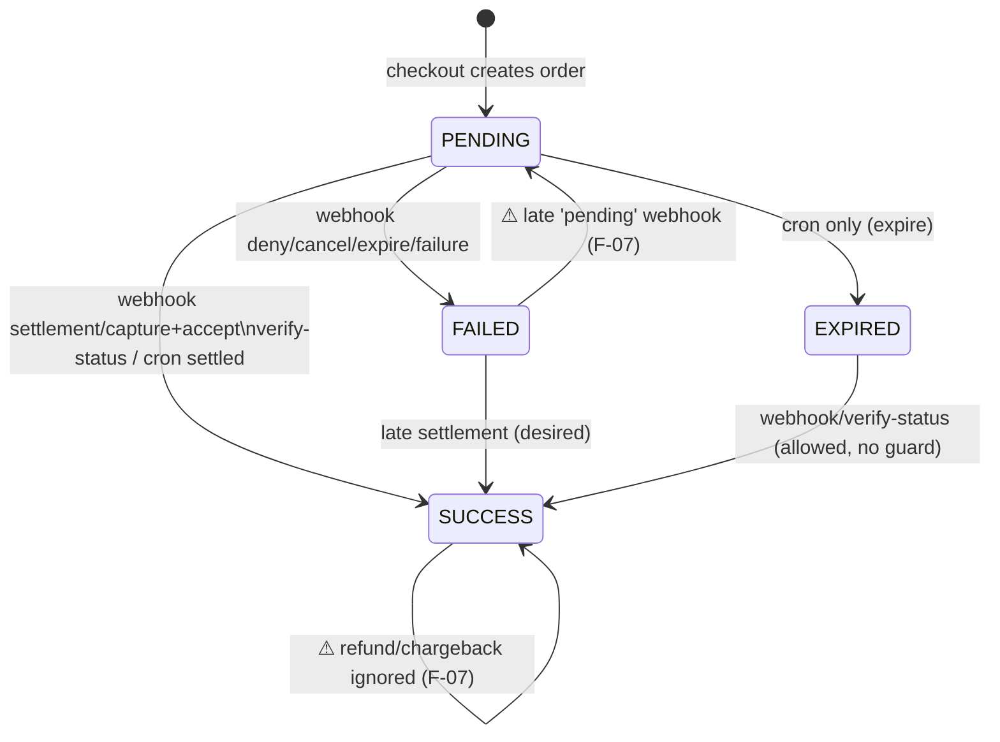
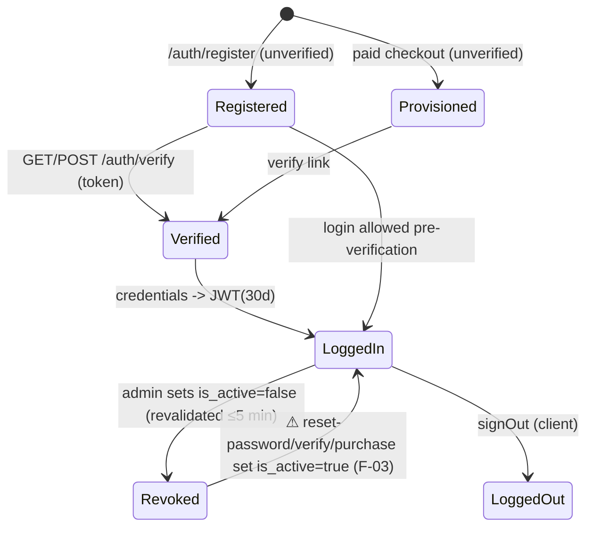
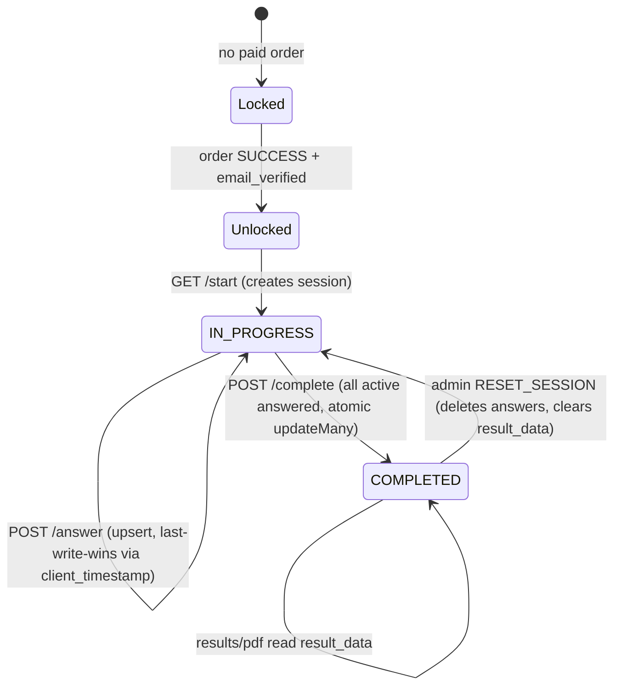

# USER FLOWS AND STATE TRANSITIONS

Basis: static tracing of code paths. Nothing here was exercised end-to-end (see TEST_RESULTS.md).

## 1. Order / payment state machine

Implemented states: `PENDING`, `SUCCESS`, `FAILED`, `EXPIRED` (no `REFUNDED`).

| Trigger | Entry point | Guards | Writes |
|---|---|---|---|
| Snap created | `POST /checkout` | server price 49000 | User (guest), Order PENDING |
| Gateway callback | `POST /notification` | signature | Order status / `fulfillPaidOrder` |
| Client success | `POST /verify-status` | Midtrans Status API | `fulfillPaidOrder` |
| Reconcile | `GET /cron/sync-midtrans` | `CRON_SECRET` | `fulfillPaidOrder` / FAILED / EXPIRED |
| `fulfillPaidOrder` | lib | status≠SUCCESS (non-atomic) | User upsert (+`is_active=true`), Order SUCCESS, VerificationToken, email |

Entitlement = exists Order SUCCESS with `user_id` **or** `customer_email` = session email, OR a previously COMPLETED session, OR role ADMIN (`access-check.ts`).

## 2. Authentication lifecycle

Notes: login does not require `email_verified`; the assessment `start` does. Password change/reset does not revoke JWTs (F-10).

## 3. Assessment lifecycle

Observations: no time limit/expiry; no retake purchase flow (admin reset only); results readable while IN_PROGRESS (F-11); `client_timestamp` is client-controlled (a far-future value makes later answers "stale" for that question — self-inflicted, Low).

## 4. Main user journeys (trace)

| Journey | Path | Observation |
|---|---|---|
| A. Register & login | register → verify email → login | OK; 409 enumeration (F-25) |
| B. Guest purchase | checkout → Snap → webhook + verify-status → email → verify → start | Race on double fulfillment (F-06); user created pre-payment (F-15) |
| C. Existing user purchase | login → checkout (auth flow) → same | Order tied to `user_id` ✔ |
| D. Forgot password | forgot → email → reset | Link poisoning (F-02); reactivation (F-03) |
| E. Track order | `/order/track` | rate-limited per instance (F-09) |
| F. Complete & view result | answers → complete → results/pdf | Atomic lock ✔; pre-computed result ✔ |
| G. Delete account | settings → "HAPUS" | no re-auth (F-22) |

## 5. Admin workflows

| Workflow | Server enforcement | Audit log |
|---|---|---|
| View students / export | ADMIN ✔ | export not logged |
| Reset session / toggle active | ADMIN ✔ | ✔ |
| Force unlock user | ADMIN ✔ | ✔ |
| Edit/deactivate question | ADMIN ✔ | ✔ (fake success on DB failure F-08) |
| Create question | ADMIN ✔ | ✘ |
| Transactions list | ADMIN ✔, paginated, DB aggregates ✔ | n/a |
